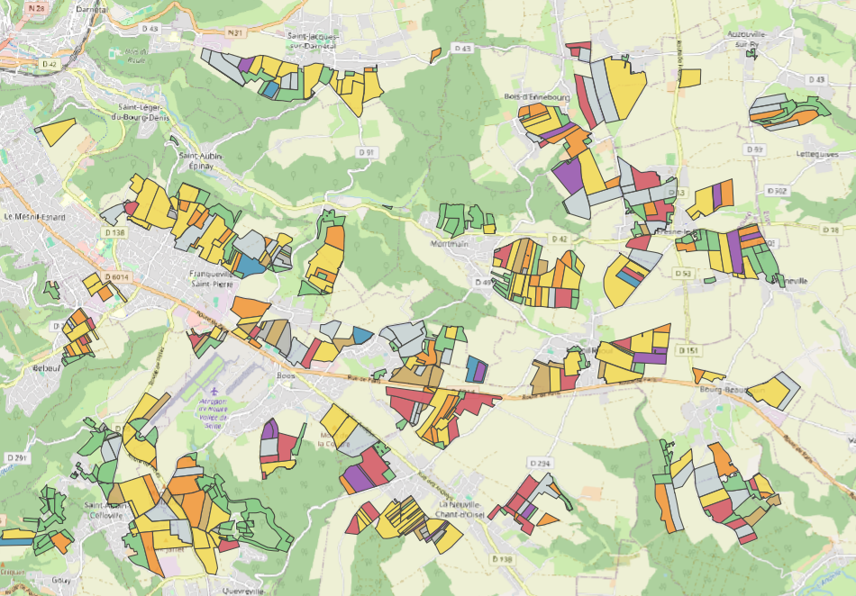

# Territoire agricole fictif

Génération en SQL (PostgreSQL / PostGIS) d'un **jeu de données agricoles fictif mais crédible** : exploitations, îlots, parcelles, historique cultural et dépôts, construits à partir de données ouvertes. L'objectif est de disposer d'un terrain de jeu réaliste pour des démonstrations SIG, sans aucune donnée réelle d'exploitant.



## En bref

| | |
|---|---|
| Emprise | Seine-Maritime, autour de Franqueville-Saint-Pierre (≈ 7 100 ha de surface agricole déclarée) |
| Exploitations | 25, de 20 à 240 ha, moyenne 112 ha |
| Parcelles | 596 parcelles réparties en îlots, ≈ 2 750 ha (≈ 40 % du territoire, le reste figurant les non-adhérents) |
| Historique | cultures N, N-1 et N-2, à partir de 17 rotations types du secteur |
| Dépôts | 4 sites, un par commune |
| Exécution | trois scripts SQL, paramétrables et rejouables |

Les **géométries** et la **culture de l'année** proviennent du RPG anonyme ; **tout le reste est fictif** : exploitations, noms, rattachements, historique, identifiants, dépôts.

## Données sources

Toutes les sources sont ouvertes et importées depuis QGIS (WFS Géoplateforme ou fichier), en Lambert-93 (EPSG:2154).

| Table brute | Source | Licence |
|---|---|---|
| `parcellaire.rpg_import` | RPG 2025 – parcelles graphiques (IGN / ASP) | Licence Ouverte Etalab 2.0 |
| `parcellaire.rpg_ilots_import` | RPG 2025 – îlots anonymes (IGN / ASP) | Licence Ouverte Etalab 2.0 |
| `referentiel.cultures_rpg_import` | Nomenclature des codes cultures du RPG | Licence Ouverte Etalab 2.0 |
| `referentiel.communes_import` | ADMIN EXPRESS – communes (IGN) | Licence Ouverte Etalab 2.0 |
| `referentiel.lieux_dits_import` | BD TOPO – lieux-dits (IGN) | Licence Ouverte Etalab 2.0 |

Fond de carte des captures : © contributeurs OpenStreetMap.

> La campagne générée est **2026** : la culture « N » est celle déclarée au RPG 2025, dernier millésime disponible. Décalage d'un an assumé.

## Structure produite

Trois tables, liées par des codes métier :

```
referentiel.depots         code_site (SITE001…), nom_site, insee, commune, geom (point)
        ▲ depot
referentiel.exploitation   code_expl (EXPL + 5 chiffres), libelle_exploitation, commune, code_insee
        ▲ code_expl
parcellaire.parcelles      campagne, num_ilot, num_parcelle, libelle, surface,
                           culture, culture_n1, culture_n2, id_logiciel_interne, geom (polygone)
```

Clés primaires en uuid, géométries en Lambert-93, RLS activé (Supabase).

## Mise en route

**Prérequis** : PostgreSQL ≥ 13 avec PostGIS installé dans le schéma `public` (testé sur Supabase), QGIS pour les imports.

1. **Créer les tables** : exécuter `sql/01_tables.sql`.
2. **Importer les données sources** depuis QGIS (*Gestionnaire BD → Importer une couche*) dans les cinq tables brutes ci-dessus : sélection sur l'emprise, SCR cible EPSG:2154, noms de champs en minuscules.
3. **Générer** : exécuter `sql/02_generation.sql`. Tout est calculé dans un schéma `travail`, consultable dans QGIS à chaque étape ; l'étape 8 écrit le résultat dans les tables finales, en une transaction.
4. **Contrôler** : exécuter `sql/03_controles.sql` (requêtes à lancer une par une).

Chaque exécution produit un territoire différent (tirages aléatoires). Les étapes 3 à 7 peuvent être relancées seules sans toucher au parcellaire.

## Paramètres

En tête de `02_generation.sql`, table `travail.param` :

| Paramètre | Valeur | Rôle |
|---|---|---|
| `nb_exploitations` | 25 | nombre d'exploitations |
| `surface_min` / `surface_max` / `surface_moy` | 20 / 240 / 112 ha | distribution des surfaces cibles |
| `hasard_distance` | 2,0 | irrégularité des parcellaires (0 = blocs ronds) |
| `part_satellites` | 0,15 | part des îlots pris à distance |
| `satellite_min` / `satellite_max` | 750 / 3 000 m | distance des îlots satellites |
| `rayon_lieu_dit` | 500 m | distance maximale parcelle → lieu-dit |
| `nb_depots` | 4 | nombre de dépôts |
| `campagne` | 2026 | campagne écrite dans les tables finales |

Les rotations sont dans une table dédiée (`travail.rotations`), modifiable sans toucher au code.

## Méthode

1. **Chargement** : parcelles et îlots RPG ; MultiPolygon → plus grand polygone ; surface recalculée (`ST_Area`) ; îlots manquants en bord d'emprise reconstitués par union de leurs parcelles.
2. **Surfaces cibles** : tirage selon une loi triangulaire bornée (20–240 ha), recalée sur la moyenne (112 ha) : beaucoup d'exploitations moyennes, quelques grandes.
3. **Répartition** : K-means sur les îlots (`ST_ClusterKMeans`, k = nombre d'exploitations) → un îlot de départ par exploitation, bien réparti sur le territoire.
4. **Croissance** : à tour de rôle, chaque exploitation prend l'îlot libre le plus proche de son parcellaire actuel (distance pondérée au hasard), et parfois un îlot « satellite » à distance (reprise, location), jusqu'à sa surface cible. Un îlot n'est jamais coupé entre deux exploitations.
5. **Numérotation** : îlots de 1 à n par exploitation, parcelles de 1 à n dans l'îlot (plus grande d'abord).
6. **Noms d'exploitation** : une liste maison, complétée par un générateur : forme juridique + lieu-dit BD TOPO le plus proche (« GAEC du Quesnay ») ou `NOM Prénom EI`. Siège = commune où l'exploitation a la plus grande surface.
7. **Libellés de parcelles** : lieu-dit BD TOPO le plus proche (≤ 500 m), utilisé une seule fois par exploitation ; les autres parcelles reçoivent un nom généré à partir de deux séries (« La Noue », « Le Pré Long de la Lande »), sans doublon dans l'exploitation.
8. **Historique cultural** : culture N = déclaration RPG. Le script cherche toutes les positions du code N dans les 17 rotations types (Caux, lin / betterave, pomme de terre, maïs-élevage, prairies temporaires, légumineuses…), en tire une, pondérée par la surface estimée de chaque rotation, puis lit N-1 et N-2 en remontant le cycle. Prairies permanentes, vergers et surfaces non productives sont reconduits.
9. **Identifiants** : numéros fictifs d'un logiciel de suivi parcellaire (`LOG` + 7 chiffres), dans l'ordre exploitation / îlot / parcelle, avec de petits trous.
10. **Dépôts** : K-means sur les centres des parcellaires (k = nombre de dépôts), un dépôt par commune réelle ; chaque exploitation est rattachée au dépôt le plus proche.
11. **Écriture finale** : en une transaction ; seule la campagne paramétrée est remplacée, les autres sont conservées.

## Contrôles

`sql/03_controles.sql` fournit une synthèse, le détail par exploitation et par dépôt, l'assolement N / N-1 / N-2, un échantillon de parcelles et neuf compteurs de cohérence qui doivent tous valoir 0 (parcelles orphelines, champs vides, identifiants ou libellés en double, surfaces incohérentes, géométries invalides…).

## Limites et pistes d'amélioration

- **Bandes tampons et bandes enherbées** : elles devraient porter le nom de la parcelle cultivée voisine.
- **Dépôts** : le centre calculé peut tomber en plein champ ; dans cette version, ils ont été replacés à la main sur la zone urbanisée la plus proche. À automatiser avec les zones d'habitation BD TOPO.
- **Historique** : le colza est un peu surreprésenté en N-1 / N-2 (effet de la rotation Caux) ; ajustable par les poids des rotations.
- **Toponymes sans article** (« Terres de la Sente ») : l'article ne peut pas être déduit, quelques noms d'exploitation sont à retoucher.
- **Rotations** : écrites pour le secteur (Seine-Maritime) ; à adapter pour un autre territoire.

## Arborescence

```
territoire-agricole-fictif/
├── README.md
├── LICENSE
├── sql/
│   ├── 01_tables.sql       structure des 3 tables
│   ├── 02_generation.sql   génération (étapes 0 à 8)
│   └── 03_controles.sql    contrôles
└── docs/
    └── captures/
```

## Licence

Code sous licence [MIT](LICENSE). Les données produites dérivent de données IGN / ASP sous Licence Ouverte Etalab 2.0 : toute réutilisation doit citer ces sources.

Joséphine STREZYK